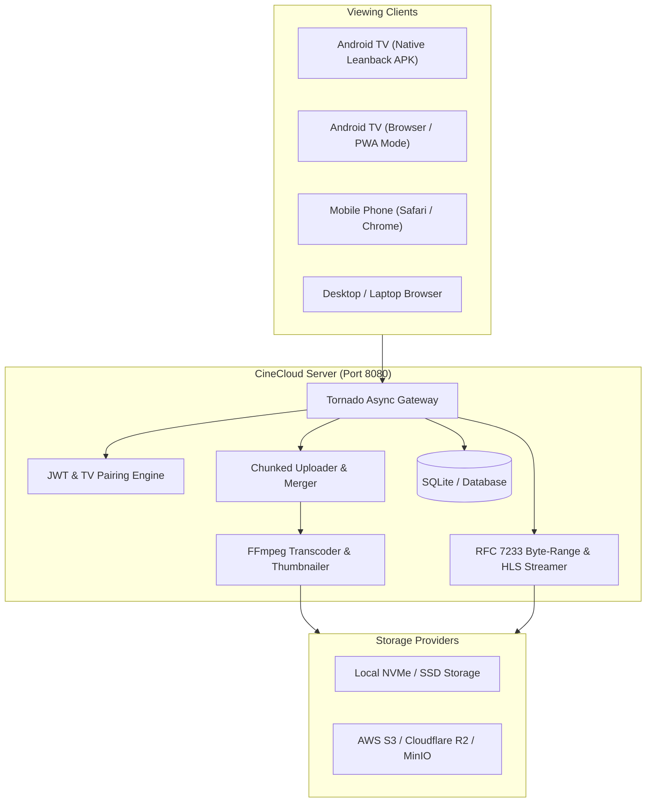

# 🎬 CineCloud - Personal Movie Streaming Platform

**CineCloud** is a personal cloud movie streaming platform inspired by modern cinematic streaming apps like **AniVortex** and **MovieBix**. It lets you upload your legally owned or authorized movie collection to cloud storage from your phone or laptop and stream them smoothly on your **Android TV**, **mobile devices**, and **computers** from anywhere over the internet.

---

## 🌟 Core Highlights

- **Cinematic Dark Theme**: Deep obsidian backdrop, neon cyan & purple accents, glassmorphic cards, and high-resolution posters.
- **Hero Spotlight & Curated Rails**:
  - Spotlight Premiere banner with 4K/HDR badges, duration, ratings, and one-click play.
  - Horizontal carousels: *Continue Watching* (with real-time progress bar), *Recently Added*, *Critically Acclaimed*, *Action & Sci-Fi Universe*, and *Suspense & Masterpieces*.
- **Android TV Remote-First Experience**:
  - **Zero-Install TV Mode**: Built-in 10-foot spatial navigation engine (`tv-nav.js`) with high-contrast luminous focus rings, auto-centering carousels, and D-pad support (Up, Down, Left, Right, OK, Back).
  - **Native Android TV App**: Complete Kotlin + AndroidX Leanback + Media3 ExoPlayer Android Studio project in `/android-tv`.
  - **TV Device Pairing**: 6-character activation code flow (like Netflix/YouTube TV) so you can pair your TV without typing passwords with a remote control.
- **Advanced Video Player**:
  - Instant byte-range seeking (RFC 7233 partial content).
  - Multi-track **Subtitle Selector** (`.vtt`, `.srt` auto-conversion).
  - Multi-track **Audio Selector** (Surround 5.1, Stereo, commentary).
  - Variable playback speed (0.75x, 1x, 1.25x, 1.5x, 2x).
  - Cross-device **Resume Watching** (syncs timestamp every 5s).
- **Responsive Admin Studio & Cloud Uploader**:
  - Upload 4K/1080p movies (even 10GB+) from mobile phone or laptop.
  - Chunked upload engine (slices files into chunks to prevent network timeouts).
  - Automatic video metadata probing (resolution, duration, codecs) & poster extraction.
  - Movie editor: update synopsis, genres, year, rating, and feature spotlights.
- **Flexible Storage**:
  - Local disk storage out-of-the-box.
  - Plug-and-play **AWS S3 / Cloudflare R2 / MinIO** adapter for infinite cloud storage.

---

## 🏗️ Architecture



---

## 🚀 Quickstart Guide

### Option 1: Run Directly with Python

```powershell
# 1. Run the CineCloud server
python backend/server.py
```

The server starts immediately at **`http://localhost:8080`**.
- Web Application: `http://localhost:8080`
- Android TV 10-Foot Mode: `http://localhost:8080/#tv`
- Admin Studio: `http://localhost:8080/#admin`

#### Default Credentials:
- **Admin**: `admin` / `admin123` (Full upload and management privileges)
- **Viewer**: `viewer` / `cinecloud2026`

---

### Option 2: Run with Docker Compose

```bash
docker-compose up -d
```

---

## 📺 Streaming on Android TV

### Method 1: Zero-Install TV Browser Mode
1. Open any web browser on your Android TV (e.g., **Silk Browser**, **TV Bro**, **JioPages**, or Chrome).
2. Navigate to: `http://<your-server-ip>:8080/#tv`
3. Use your TV remote's D-pad to navigate. The app automatically detects TV mode, highlights cards with glowing focus borders, and handles Play/Pause/Seek with remote buttons.

### Method 2: Native Android TV App (Leanback APK)
1. Open the `/android-tv` folder in **Android Studio**.
2. Click **Build** > **Build Bundle(s) / APK(s)** > **Build APK(s)**.
3. Install `app-debug.apk` onto your TV using ADB over Wi-Fi:
   ```bash
   adb connect <your-tv-ip>:5555
   adb install -r android-tv/app/build/outputs/apk/debug/app-debug.apk
   ```
4. Enter your CineCloud server URL on initial launch.

---

## ☁️ Cloud Storage (AWS S3 / Cloudflare R2 / MinIO)

To store your movie library in cloud object storage instead of your local disk:
1. Copy `.env.example` to `.env`:
   ```ini
   STORAGE_DRIVER=s3
   S3_BUCKET_NAME=my-cinecloud-movies
   S3_ENDPOINT_URL=https://<account_id>.r2.cloudflarestorage.com
   S3_ACCESS_KEY=your_key_id
   S3_SECRET_KEY=your_secret_key
   S3_REGION=auto
   ```
2. Videos uploaded through the Admin Studio will be streamed directly from your cloud bucket with presigned streaming tokens.

---

## 📁 Repository Structure

```
├── backend/
│   ├── server.py              # Tornado asynchronous web and streaming server
│   ├── config.py              # Port, JWT secrets, storage paths, transcoding settings
│   ├── database.py            # SQLite database with automatic migrations & seeds
│   ├── auth.py                # PBKDF2 password hashing & HMAC-SHA256 JWT tokens
│   ├── storage/
│   │   ├── base.py            # Storage adapter interface
│   │   ├── local_storage.py   # Local byte-range streaming adapter
│   │   └── s3_storage.py      # AWS S3 / Cloudflare R2 cloud storage adapter
│   ├── transcode/
│   │   └── processor.py       # FFmpeg probe, thumbnail extraction & HLS packaging
│   └── handlers/
│       ├── auth_handlers.py    # Login, register, profile, TV device pairing
│       ├── movie_handlers.py   # Movie listing, search, categories, CRUD
│       ├── stream_handlers.py  # RFC 7233 byte-range streaming & WebVTT delivery
│       ├── progress_handlers.py# Cross-device resume watching sync
│       └── upload_handlers.py  # Resumable chunked video uploader
├── web/
│   ├── index.html             # Single-Page App with dark cinematic UI
│   ├── css/
│   │   ├── styles.css         # Modern dark theme, glassmorphic cards, TV focus rings
│   │   └── player.css         # Custom fullscreen video player styling
│   └── js/
│       ├── app.js             # Main router & state manager (Auth, Rails, Modals)
│       ├── player.js          # Player engine (Subtitles, Audio, Speed, Resume prompt)
│       ├── tv-nav.js          # Android TV D-Pad 10-foot remote navigation engine
│       └── admin.js           # Admin Studio (Chunked upload & movie management)
├── android-tv/
│   ├── app/
│   │   ├── src/main/java/com/cinecloud/tv/
│   │   │   ├── MainActivity.kt     # Leanback BrowseSupportFragment TV UI
│   │   │   ├── PlaybackActivity.kt # ExoPlayer remote-controlled video playback
│   │   │   └── api/CineCloudApi.kt # REST client with token auth
│   │   └── AndroidManifest.xml     # Leanback launcher configuration
│   ├── build.gradle
│   └── README.md
├── docker-compose.yml         # Containerized production stack
├── Dockerfile                 # Python 3 + FFmpeg container
├── requirements.txt           # Python dependencies
└── .env.example               # Environment variable templates
```

---

## 🔒 Security & Privacy

- **Private Streaming Tokens**: Direct video stream URLs require signed JWT tokens with expiration to prevent hotlinking and unauthorized access.
- **PBKDF2 Password Hashing**: Passwords stored with cryptographic salts and 100,000 iterations.
- **Zero Third-Party Tracking**: Your personal movie library stays completely private on your own cloud instance.
